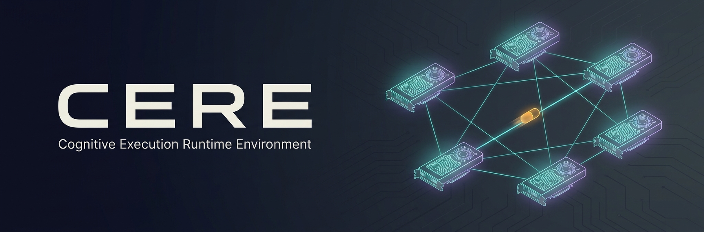

<p align="center"></p>

# CERE: Cognitive Execution Runtime Environment

[](LICENSE)
[](https://github.com/Cklaus1/cere/tags)
[](https://github.com/Cklaus1/cere/issues)
[](https://github.com/Cklaus1/cere/discussions)

**Private AI on hardware you control.**

**Your GPUs. Your agents. Your rules.**

CERE is an inference engine for coding agents: a runtime for long-lived agent sessions with state, tools and pauses,
not a stateless request server. It speaks the OpenAI and Anthropic APIs, so the agent you already use can point at it.

## Why CERE

- **Fast per agent.** Single-session speed is what an agent feels, and it is what CERE optimizes: 264 tok/s
  single-stream decode on Qwen3.8-Flash-Next, 4.26 ms per output token on served production traffic, and 198 tok/s
  for Inkling 2 Mini with MTP drafts, all on one RTX PRO 6000 Blackwell.
- **Same output, just faster.** Speculative decoding is lossless: drafted output equals plain greedy decoding on
  every measured row (54/54, plus 14/14 with a hot cache). Every speed change is checked against a 28-prompt
  byte-identity gate; levers that change output stay opt-in or pass a quality screen first. Agent runs are
  reproducible.
- **Sessions that survive.** Each session keeps its prefix state, so a returning 18K-token conversation gets its
  first token in about 80 ms instead of 1.78 s cold. With `park_on_stop` on, that state survives a restart (a
  72K-token session answers in under 190 ms instead of about 7 s). Streams are resumable, and cancellation and
  backpressure are explicit.
- **Your GPUs, pooled, your rules.** Federate machines owned by different people into one pool. Per-scope tiers
  (own, team, provider) decide where a conversation may run; when no allowed machine is free, the request queues
  instead of spilling. A session can move between installs as sealed state, and the client picks whichever of
  shipping state or re-prefilling is faster on the link.
- **One engine, NVIDIA and AMD.** CUDA on Blackwell runs in production; a native Vulkan executor serves the same
  models on AMD Ryzen AI Max (Radeon 8060S), with the limits in the [support matrix](#support-matrix).
- **Research hooks built in.** Opt-in activation capture, interventions and steering vectors on Qwen3.8-Flash-Next
  (CUDA). They are off by default and bit-identical when unused: [docs/RESEARCH_HOOKS.md](docs/RESEARCH_HOOKS.md).

## Who it's for

- Individuals and small teams running Claude Code-style coding agents on their own Blackwell or AMD hardware.
- Teams whose code and prompts must not leave machines they control.

**How this was built:** CERE was developed with AI coding agents under human review.

## Quick start

Qwen3.8-Flash-Next on one RTX PRO 6000 Blackwell (details and the other models in
[Install and run](#install-and-run)):

```sh
# 1. Build (CPU) and the CUDA executor
cargo build --release --workspace --locked
make executor-cuda CERE_MODEL=qwen38-flash-next

# 2. Convert the FP4-Local checkpoint you downloaded, then prepare and verify an artifact
target/release/cerec convert "$CKPT" --out "$SRC" --converter-git-sha "$(git rev-parse HEAD)" --format s3
target/release/cerec prepare "$SRC" --name qwen38-flash-next-fp4local-cere-s3 --out "$ARTIFACTS" \
  --families configs/artifacts/qwen4_exp-nvfp4-plenvfp4-mxfp8.families.json \
  --profile configs/artifacts/profiles/rtxpro6000bw-plehost-nvfp4-mxfp8-text-v1.json
target/release/cerec verify "$ARTIFACTS/<artifact id>" --expected-manifest-sha256 <sha256> --mode full

# 3. Pin your library and artifact in the profile, then run cered
export CERE_OPERATOR_TOKEN=... CERE_TOKEN_NATIVE_A=...
CUDA_VISIBLE_DEVICES=<GPU UUID> target/release/cered --config configs/runtime/native-g0-spec.toml
```

Point a client at it:

```sh
# OpenAI-compatible clients
export OPENAI_BASE_URL=http://127.0.0.1:18309/v1 OPENAI_API_KEY=$CERE_TOKEN_NATIVE_A
# Anthropic-compatible clients (set api_compat_anthropic = true on the deployment; bearer auth only)
export ANTHROPIC_BASE_URL=http://127.0.0.1:18309 ANTHROPIC_AUTH_TOKEN=$CERE_TOKEN_NATIVE_A
export ANTHROPIC_MODEL=Qwen3.8-Flash-Next
```

## Federate two machines

One `cered` is the coordinator; each other machine runs `cere-worker` in front of its own model server. Workers
are SGLang backends in this release (`deployments.kind = "sglang_http"`), and coordinator and workers talk mutual-TLS
gRPC over loopback or a 100.64.0.0/10 private network such as a Tailscale tailnet. On the coordinator:

```toml
[federation]
cluster_id = "home-pool"
coordinator_id = "cere-coordinator"
listen = "100.64.0.1:7443"
principal = "cere-coordinator"
ca_file = "/etc/cere/pki/ca.pem"
cert_file = "/etc/cere/pki/coordinator.pem"
key_file = "/etc/cere/pki/coordinator-key.pem"

[[federation.workers]]
worker_id = "worker-a"
endpoint = "https://100.64.0.2:7443"
principal = "cere-worker-a"
max_inflight = 4
owner = "alice"          # alice's machine: her requests go first
tier = "team"            # what it is to everyone else; scopes opt in with [[auth.scopes]] allowed_tiers

[federation.workers.expect]
served_model_name = "Qwen3.8-Flash-Next"
tp_size = 1
kv_cache_dtype = "fp8_e4m3"
```

On the worker, start from `configs/worker/node-b-mock.toml` (set `listen`, `[coordinator] endpoint`, the PEM paths
and `[backend] base_url`), check it and run it:

```sh
cere-worker --check-config worker.toml && cere-worker --config worker.toml
```

Move a session to another install (the key never leaves the client; the tool refuses a destination outside your
allowed tiers):

```sh
python3 scripts/live/teleport.py keygen
python3 scripts/live/teleport.py move --source http://127.0.0.1:18309 --dest http://127.0.0.1:18309 --dest-ssh other-box \
    --source-token-env CERE_TOKEN_ME --dest-token-env CERE_TOKEN_ME --model Qwen3.8-Flash-Next \
    --messages chat.json --prompt-tokens 72000 --dest-tier own
```

Details: [docs/MULTI_NODE.md](docs/MULTI_NODE.md), [docs/WORKER_PROTOCOL.md](docs/WORKER_PROTOCOL.md) and the
"Federation" section of [docs/CONFIGURATION.md](docs/CONFIGURATION.md).

## What's inside

A Rust control plane (`cered`) owns admission, scheduling, sessions, auth, metrics and the API surface; a native
executor library loaded through a versioned C ABI (`executor/include/cere_executor.h`) runs the model on the GPU.
There are three executors:

- **CUDA** (`executor/cuda/`): Blackwell `sm_120a` (RTX PRO 6000 Blackwell, RTX 5090).
- **Vulkan** (`executor/vulkan/`): AMD RDNA 3.5 through Mesa RADV (tested on the Radeon 8060S / gfx1151).
- **HIP** (`executor/hip/`): a port of the CUDA executor to ROCm on gfx1151; a parity baseline, not a serving path.

Supported models: **Qwen3.8-Flash-Next** (NVFP4 / FP4-Local MoE with MTP speculation, vision, tool calls,
structured output) and **Inkling 2 Mini** (`thinkingmachines/Inkling-2-Mini`, with MTP drafts and vision on CUDA).
DICE-8B runs as a dev profile. CERE can also front SGLang or llama.cpp servers (`sglang_http`,
`cere-llamacpp-shim`) and federate workers across hosts.

## Support matrix

Status words: **production** = serving real traffic continuously; **tested** = measured end to end through `cered`
on that hardware; **partial** = runs with the limits listed; **untested** = no measurement exists. The numbers come
from the development repository's benchmark reports (not published here), dated; they are single-host measurements,
not guarantees.

| Model | Hardware / backend | Status | Evidence (date) | Config |
|---|---|---|---|---|
| Qwen3.8-Flash-Next | RTX PRO 6000 Blackwell (96 GB), CUDA | **production** since 2026-11-11 | 4.26 ms per output token (234.8 tok/s per request) on served traffic, 16 decode rows, 262,144-token context (2026-11-21). Default dev profile `-v29`: 264.1 tok/s single-stream decode with speculation, 534.3 tok/s at 4 streams; TTFT 155 ms at 1.2K tokens (2026-10-20) | `configs/runtime/prod-t4.toml`, `native-g0-spec.toml` |
| Inkling 2 Mini | RTX PRO 6000 Blackwell, CUDA | **tested** (dev lane, not in production) | 198.2 tok/s single-stream with MTP drafts vs 119.6 without; 336.2 tok/s at 4 streams; 785.5 tok/s aggregate at 64 streams without drafts (2026-11-24). Quality gate is report-only | `configs/runtime/native-g0-inkling.toml`, `native-g0-inkling-plain.toml` |
| Inkling 2 Mini | Radeon 8060S (gfx1151), Vulkan | **partial**: one session, greedy only, text only, no speculation | 26.0 tok/s decode at short context, 23.8 tok/s at 4.8K; prefill 556.8 tok/s at 4.8K (2026-11-24) | `configs/runtime/native-amd-inkling-vk.toml` |
| Qwen3.8-Flash-Next | Radeon 8060S (gfx1151), Vulkan | **partial**: 32K context; tool calls refused | 17.6 tok/s plain, 19.3 tok/s with speculation on served bodies; 48/48 outputs equal the reference (2026-11-21) | `configs/runtime/amd-serve.toml`, `amd-serve-spec.toml` |
| Qwen3.8-Flash-Next | Radeon 8060S, HIP | **partial**: parity baseline only | 23.6 tok/s plain decode through `cered` (2026-11-21) | `configs/runtime/native-amd-s3.toml` |
| Qwen3.8-Flash-Next (IQ3_XXS GGUF) | Radeon 8060S, llama.cpp via `cere-llamacpp-shim` | **tested** (lab only) | llama-bench tg128: 28.7 t/s Vulkan, 25.5 t/s HIP (2026-11-11) | `configs/runtime/amd-flashnext.toml` |
| Inkling 2 Mini | RTX 5090 (32 GB), CUDA | **untested** | Planned: the 20 GB pack leaves about 10 GiB for KV (one 256K or two 128K sessions; 1M context does not fit). No measurement yet | none |
| Qwen3.5-4B | RTX 5090, CUDA | **untested** (port in progress, not in this release) | The port passes its numerical gates on an RTX PRO 6000; acceptance on the RTX 5090 has not passed | none |
| Qwen3.8-Flash-Next | RTX 5090 (32 GB) | **not supported** | Needs about 77 GB of VRAM plus a 28.8 GB PLE table in pinned host RAM; no 32 GB profile exists | none |
| DICE-8B | RTX PRO 6000, CUDA | **partial**: dev only, one session, BF16, greedy | Served requests all returned 200 (2026-11-23); no throughput claim | `configs/runtime/native-g0-dice8b.toml` |

The AMD numbers need a unified-memory part with enough GTT: Qwen3.8-Flash-Next uses about 104 GB, so a 128 GB
Ryzen AI Max+ class machine. The Vulkan K2 path needs `VK_KHR_cooperative_matrix` (without it Inkling decode drops
to 7.5 tok/s).

Federation and session state:

| Feature | Setup | Status | Evidence (date) |
|---|---|---|---|
| Team pools: owner priority, per-scope tiers, interactive/batch classes, owner-only windows | one `cered` coordinator, `cere-worker` agents, SGLang-backed workers | **tested** with mock backends on one host | all five checks pass: owner queue wait p99 4.47 s under a 5 s cap, batch keeps 10.5 % of contested grants, 0 grants to a disallowed tier, 0 non-owner grants inside an owner-only window (2026-11-23) |
| Federation with a real model across two hosts | `gemma-4-e4b-it` on two SGLang servers, one of them a second host's RTX 5090 | **tested** | live placement, managed load/unload and session migration (2026-10-08); a moved turn re-prefills, and the same request may answer differently on the two workers |
| Native-executor workers in a federation | | **not supported** | federation workers are SGLang agents only in this release |
| Session teleport (sealed prefix state between installs) | Qwen3.8-Flash-Next, CUDA, two installs on one host | **tested** | 28/28 continuations after import byte-identical; first token after import at 0.045 of cold TTFT at 18K tokens and 0.022 at 72K (2026-11-23) |
| Session teleport across hosts | the same, through a sealed vault over a 1 GbE LAN | **partial** | works and every blob on the remote disk stayed sealed, but re-prefilling was faster at every size up to 128K, so the client answers "replay" on that link (2026-11-23) |
| Warm restart (parked session state) | Qwen3.8-Flash-Next, CUDA | **tested** | 72K-token session: first token 163-189 ms after a restart vs 6.9-7.2 s cold, answers identical; a library change refuses the parked state and replays (2026-11-23) |
| One forward pass split across hosts (tensor or pipeline parallel) | | **not supported** | |

## Requirements

- **Build (CPU only):** Rust 1.85.1 (pinned by `rust-toolchain.toml`), `protoc` (protobuf-compiler), a C++17
  compiler, Python 3.11+ with `jsonschema` and `PyYAML` for the tests (`requirements-dev.txt`).
- **CUDA executor:** CUDA 13.0 toolkit (nvcc 13.0.88 is the toolchain of record), CMake ≥ 3.28, Ninja, g++ 13,
  `readelf`. The library targets `sm_120a` only (no PTX): it runs on compute capability 12.0 Blackwell cards. An
  NVIDIA driver with CUDA 13 support.
- **Vulkan executor:** g++ 13, `glslc` (shaderc 2023.8 / glslang 14), `libvulkan-dev` 1.3.275, Mesa RADV 25.2 or
  newer with `VK_KHR_cooperative_matrix`.
- **HIP port:** ROCm 7.2 (`hipcc --offload-arch=gfx1151`, `hipblaslt`).
- **Tokenizer sidecar (at serve time):** Python with `tokenizers` and `transformers`; for images, tool calls and
  grammars also `torch`, `torchvision`, `Pillow`, `xgrammar` and `sglang`.
- **Host RAM:** Qwen3.8-Flash-Next pins its PLE table in host RAM (28.8 GB for the S3 artifact); the production
  profile wants MemAvailable ≥ PLE + 16 GiB + an 8 GiB snapshot arena at start. `cerec prepare` and `cerec verify`
  refuse below 16.5 GiB free.

## Install and run

### 1. Build and test (no GPU)

```sh
cargo build --release --workspace --locked
make ci            # validate, fmt, clippy, toy executors, C ABI checks, host tests, Rust and Python suites
```

`make ci` runs everything on the CPU: the Rust tests drive `cered` against toy executors built from the real host
layer (`make toy-executors`). Tests that need GPU hardware or model-derived reference data skip with a message.

### 2. Build an executor

```sh
make executor-cuda CERE_MODEL=qwen38-flash-next     # or CERE_MODEL=inkling-2-mini; writes build/native-<model>/
CERE_MODEL=inkling-2-mini sh executor/vulkan/build_lib.sh   # Vulkan; writes build/vulkan/
```

See [docs/BUILDING.md](docs/BUILDING.md) for toolchains, provenance (`build.json`) and pinning.

### 3. Prepare a model artifact

`cerec` turns a Hugging Face checkpoint into a verified CERE artifact (a manifest of every tensor with its SHA-256):

```sh
cargo build --release --bin cerec
# Inkling 2 Mini (thinkingmachines/Inkling-2-Mini, Apache-2.0): download and pin the source
python3 scripts/native/model_source.py tests/fixtures/model_configs/inkling-2-mini/source.json "$SRC" --mode download --hash-weights
target/release/cerec prepare "$SRC" --name inkling-2-mini-nvfp4-mxfp8 \
  --families configs/artifacts/inkling2_loop-nvfp4-mxfp8.families.json \
  --profile configs/artifacts/profiles/rtxpro6000bw-inkling-text-v1.json --out "$ARTIFACTS"
target/release/cerec verify "$ARTIFACTS/<artifact id>" --expected-manifest-sha256 <sha256> --mode full
```

Qwen3.8-Flash-Next is converted from its FP4-Local checkpoint first (`cerec convert ... --format s3`), then prepared
with `configs/artifacts/qwen4_exp-nvfp4-plenvfp4-mxfp8.families.json`. [docs/ARTIFACT_FORMAT.md](docs/ARTIFACT_FORMAT.md)
and [docs/MODEL_COMPILER.md](docs/MODEL_COMPILER.md) describe the format and the compiler. A verify stamp does not
travel between hosts: run `--mode full` again after copying an artifact.

### 4. Configure and run `cered`

Start from a shipped profile (for example `configs/runtime/native-g0-inkling.toml`) and set, under
`[deployments.native]`: `library` and `library_sha256` (your build), `artifact_dir` and `expected_manifest_sha256`
(your artifact), `device_uuid` (`nvidia-smi -L`; `"vk:0"` on Vulkan) and the `sidecar` path. After a rebuild,
`python3 scripts/native/lock_native.py --build-json build/native-<model>/build.json` re-pins the library in the
config and its deployment lock, and `python3 scripts/pin_configs.py --write` refreshes the config hashes.

```sh
export CERE_OPERATOR_TOKEN=... CERE_TOKEN_NATIVE_A=...
CUDA_VISIBLE_DEVICES=<the GPU UUID> target/release/cered --config configs/runtime/native-g0-inkling.toml
```

`cered` refuses to become ready when any pin (library, artifact, tokenizer, template, device) does not match:
mismatches are reported by name on `/readyz`.

### 5. Call the API

```sh
curl -s http://127.0.0.1:18309/v1/chat/completions \
  -H "Authorization: Bearer $CERE_TOKEN_NATIVE_A" -H 'Content-Type: application/json' \
  -d '{"model": "Inkling-2-Mini", "messages": [{"role": "user", "content": "Hello"}], "max_tokens": 64}'
```

Endpoints: `/v1/chat/completions`, `/v1/responses` and `/v1/models` (OpenAI-compatible, streaming included),
`/v1/messages` (Anthropic Messages-compatible), `/v1/cere/*` (sessions, state export/import, request events, stats),
`/metrics` (Prometheus), `/healthz` and `/readyz`. The model name is the profile's `served_model_name`. See
[docs/API.md](docs/API.md), [docs/CONFIGURATION.md](docs/CONFIGURATION.md) and
[docs/OBSERVABILITY.md](docs/OBSERVABILITY.md).

Opt-in research hooks (activation capture, interventions, steering vectors; Qwen3.8-Flash-Next on CUDA, off by
default and bit-identical when unused) are described in [docs/RESEARCH_HOOKS.md](docs/RESEARCH_HOOKS.md).

## Repository layout

| Path | What |
|---|---|
| `crates/cere-runtime` | `cered` (server), `cere-worker` (federated worker), `cere-native` (executor probe), `cere-rpc-probe`; the scheduler and API |
| `crates/cere-compiler` | `cerec`: artifact inventory, conversion, prepare, verify |
| `crates/cere-core`, `cere-proto` | shared types; the worker gRPC protocol (`proto/`) |
| `crates/cere-llamacpp-shim`, `cere-mock-sglang` | the llama.cpp adapter; a mock SGLang server for tests |
| `executor/` | the C ABI, the CUDA / Vulkan / HIP executors, model descriptors, host tests |
| `configs/` | runtime profiles, deployment locks, artifact families and profiles |
| `schemas/`, `examples/` | JSON Schemas for every contract and example documents |
| `scripts/` | the tokenizer sidecar, artifact and lock tooling, fixture generators |

Some documents and comments refer to development scripts, design notes and benchmark reports that are not part of
this repository.

## Model data in this repository

No model weights and no tensors computed from them are included. The safetensors under `tests/fixtures/model_src/`
and `examples/artifact/` are synthetic (written by `scripts/fixtures/make_model_fixture.py`). Tests that compare
against reference outputs of real models (the Inkling 2 Mini and DICE-8B reference sets, the GPU oracles under
`executor/tests/gpu/`) skip without their data; [docs/BUILDING.md](docs/BUILDING.md) says how to regenerate it.
The API, tool-call, grammar and detokenizer fixtures under `tests/fixtures/native/` hold token IDs produced with the
Qwen3.8-Flash-Next tokenizer (Qwen Community License 1.0); see [THIRD_PARTY_NOTICES.md](THIRD_PARTY_NOTICES.md).

## Community

- **Questions, ideas, show-and-tell:** [GitHub Discussions](https://github.com/Cklaus1/cere/discussions).
- **Bugs and feature requests:** [GitHub Issues](https://github.com/Cklaus1/cere/issues).
- **Pull requests** are welcome; every commit needs a DCO sign-off (`git commit -s`), see
  [CONTRIBUTING.md](CONTRIBUTING.md).
- **Security reports:** privately, through GitHub's private vulnerability reporting; see [SECURITY.md](SECURITY.md).

## Releases

Releases are tagged snapshots of the development repository: each one is a fresh export, tagged `v<version>`
(the first is `v0.6.0`). See [CHANGELOG.md](CHANGELOG.md).

## Licensing

- **CERE's own code** is MIT-licensed, see [LICENSE](LICENSE).
- **Vendored third-party code** (FlashInfer with its TensorRT-LLM and CUTLASS headers, a Strata adaptation) keeps its
  own license; see [THIRD_PARTY_NOTICES.md](THIRD_PARTY_NOTICES.md).
- **Model weights are not included.** Qwen3.8-Flash-Next (Qwen Community License 1.0; the NVIDIA FP4-Local
  checkpoint also under the NVIDIA Open Model Agreement), Inkling 2 Mini (Apache-2.0) and DICE-8B (Apache-2.0) are
  licensed by their publishers: obtain them yourself and accept their terms.
- **CUDA:** executor binaries built from this repository statically link NVIDIA CUDA libraries (`cudart_static`,
  `cublasLt_static`, `culibos`) and are subject to the NVIDIA CUDA Toolkit EULA when you distribute them.
